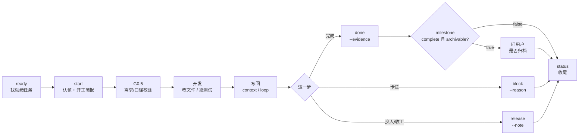
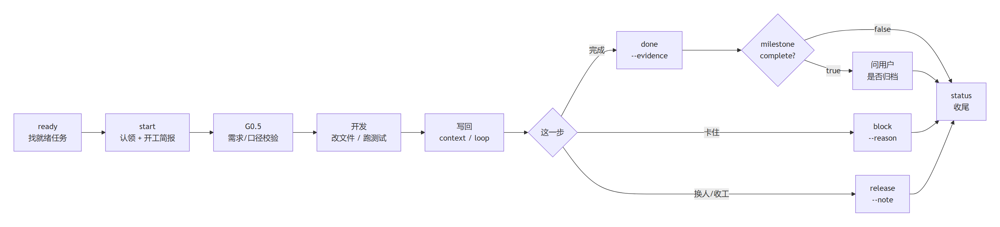

# dsh-project-todo · 项目待办

> 一个项目一份待办：人在 Web 看板上看，Agent 用终端 `ptodo` 认领、写回、交接。
> 数据只有一份（`docs/ptodo/`），CLI、页面和跨工具技能共用同一套状态机与文件锁。

```text
ready → start（认领+简报）→ G0.5 校验 → 实现 ⇄ context/progress/block/release
      → done --evidence →（非默认里程碑全完成？问用户归档）→ status + 结论行
```

完整泳道图、时序图、状态机见 [docs/HELP.md](docs/HELP.md)。

## 为什么需要它

Agent 写代码很快，但「做到哪、为什么这么选、下一步是什么、谁在等」最容易丢。常见情况：

- 会话结束，任务状态只留在聊天记录里，换个人或换个工具就接不上；
- 同一件事被两个 Agent 各做一遍，或者互相把文件覆盖；
- 「完成了」只是口头结论，没有版本、没有可复核的证据；
- 用户想知道项目还有什么没做，只能翻会话或问 Agent。

`dsh-project-todo` 把待办从聊天记录搬到项目文件，并给 Agent 一套固定动作：

- **唯一事实源**：`docs/ptodo/todos.json`；禁止手改，统一走 `ptodo`。
- **Agent 六个动作**：`ready / start / done / release / block / create`，覆盖找活、认领、完成、交接、阻塞、建任务。
- **开工有简报**：`start` 一次返回阶段、目标、上游版本/证据、资料、未关闭事项、前置条件和下一步。
- **交接不靠口头**：`release` 把「中断于 …」和交接说明写回任务，下一位 `start` 直接看到。
- **跨工具**：技能可装到 DSH、Claude、Codex、WorkBuddy、ZCode 等 7 个位置，命令和数据不绑定某个编辑器。

它**不是**会话内计划清单（那是 DSH 的 `todo_write`），也**不是** Jira 式协作系统：没有评论、附件和多人指派。

## 30 秒上手

要求 Node.js >= 20。

```bash
cd dsh-plugins/dsh-project-todo
npm link                 # 开发期链接安装；或 npm i -g .
ptodo doctor             # 自检：包/Node/根目录/看板/git/actor/技能
ptodo init               # 首次：建空看板（已有数据会提示已存在）
ptodo skill install --targets all   # 可选：装到 7 个 Agent 工具
```

建一条任务并直接开工（`create` 默认把负责人设成你，所以它不会出现在 `ready` 列表里，直接 `start` 即可）：

```bash
ptodo task create --title "导出接口支持流式" --priority P1 --tags "KB,api"
ptodo task start T-0001
ptodo context decision T-0001 "选流式，避免大文件内存峰值"
ptodo task done T-0001 --evidence "接口测试 12/12 通过" --version v0.1.0
```

> 非 git 目录必须带 `--version`，否则 `done` 以 `[INVALID]`（退出码 5）拒绝——这是刻意的，防止谎言式完成。

## 生命周期

一张图看懂每个角色在什么时机做什么：





六道门（完整说明见 [docs/HELP.md](docs/HELP.md#3-生命周期总览泳道图)）：

| 门 | 时机 | 命令 | 要拿到什么 |
|---|---|---|---|
| G0 开工 | 任何要改文件/跑构建的回合开始 | `ptodo task ready --limit 3` | 就绪叶子；空则建任务或换一条 |
| G1 认领 | 改文件之前 | `ptodo task start <id>` | 开工简报；顺带完成认领 |
| G0.5 校验 | 认领后、动手前（仅配置了需求注册表的项目） | `ptodo context decision <id> "..."` | 口径/CR/版本实测结论写回 |
| G2 进行中 | 每完成一个子步骤、卡住、换人 | `context progress / loop`、`block`、`release` | 状态与原因落库，下一位可接 |
| G3 完成 | 证据可复核之后 | `ptodo task done <id> --evidence "..."` | 版本/证据/解锁下游；非默认里程碑完成时问归档 |
| G4 收尾 | 给用户结论之前 | `ptodo task status` | 计数 + 结论行，不再靠记忆 |

> 纯只读问答、以及不改代码/文档的运维动作，可以跳过认领和 G0.5；其余开发任务必须按门走。

## 核心概念

| 概念 | 说明 |
|---|---|
| 三层组织 | 里程碑 `M-0001` → 阶段 `S-0001` → 任务 `T-0001`；任务只挂阶段。默认「默认 / 未分类」自动存在、不可删。 |
| 就绪 `isReady` | 叶子 + 未开始 + 无人持有 + 硬依赖已完成 + 必填前置满足 + 所属阶段/里程碑未归档。 |
| 硬依赖 / 软依赖 | 硬依赖未完成 → 任务不可 ready/start；软依赖只提示。组织（阶段/里程碑）依赖永远不阻塞任务。 |
| 前置条件 | `task_done / tag_done / resource_approved / commit_exists / manual_confirm`，多个 AND；`manual_confirm` 需 `pre confirm`。 |
| 开工简报 | `start` 返回的只读投影：阶段/目标/进度/决策/上游/资料/未关闭事项/前置/下一步。 |
| 交接 | `release` 写「中断于 …」+ note 进 `openLoops`，并生成 handoff。 |
| Actor vs person | actor 是工具身份（`--by` 或 `PTODO_ACTOR`，建议 `工具:名字`）；person 是完成人/负责人，取 git `user.name`。 |
| 父任务 | 容器，不可认领/完成/阻塞；状态由子任务自底向上汇总。 |

## Agent 六个动作

| 命令 | 什么时候用 | 关键行为 |
|---|---|---|
| `ptodo task ready [--limit N]` | 回合开始、不知道做什么 | 只列就绪叶子；已指派给你的不在里面 |
| `ptodo task start <id>` | 改文件前 | 检查就绪 + 认领 + 返回开工简报；本人任务幂等 |
| `ptodo task done <id> --evidence "..."` | 验证通过后 | 仅持有者；自动版本/证据；解锁下游；返回 `milestone.complete` |
| `ptodo task release <id> --note "..."` | 换人、收工、等外部输入 | 任务回 `open`；进度改写「中断于 …」；note 进交接 |
| `ptodo task block <id> --reason "..."` | 被外部条件卡住 | 任务变 `blocked`；原因进 `openLoops`；`unblock` 恢复 |
| `ptodo task create --title "..."` | 发现新工作 | ID 自动分配；默认负责人=你；可带 `--blocked-by` |

### 开工简报长什么样

```text
开工简报：T-0007 导出接口支持流式
S-0002 实现 / M-0001 Q4 交付 · P1 · 紧急 普通
目标：导出 10 万行不 OOM，P95 < 2s
进度：中断于 2026-11-04 16:34：接口骨架完成，待补测试
最近决策：
  - 选择流式导出，避免大文件内存峰值（codex:zhangsan）
前序已完成：
  - T-0006 导出协议冻结 · 版本 a1b2c3d · 证据 评审纪要第 3 节
未关闭事项：
  1. 等客户端确认字段名
下一步：先处理未关闭事项：等客户端确认字段名
```

简报已经包含阶段、目标、上游、资料、前置和 `nextStep`；**不要再 `task get` 重复读一遍**。

### 完成与归档

```text
$ ptodo task done T-0007 --evidence "接口测试 12/12 通过" --version v0.1.0
已完成 T-0007（版本 v0.1.0）；解锁 T-0008
里程碑 M-0001 已全部完成；归档前先询问用户：ptodo admin archive-batch --milestone M-0001
```

看到 `milestone.complete=true` **且 `milestone.archivable=true`**（文本输出也会多一行提示）时：

1. **先问用户**「里程碑 M-0001（名称）已全部完成，是否归档？」；
2. 用户同意后才执行 `ptodo admin archive-batch --milestone M-0001`；
3. 用户拒绝则写回 `ptodo context loop T-0007 "里程碑 M-0001 待归档，用户暂不归档"`。

**默认里程碑（`code=default`，收件箱）不归档**：它的 `archivable=false`，文本也不出归档提示——`complete=true` 只表示「这个里程碑下的任务都做完了」，直接给结论行即可。
未确认不得归档；`complete=false`、`archivable=false` 或 `milestone=null` 不要提归档。

## 命令总览

### 全局参数

`ptodo <命令> [子命令] [参数] [--root DIR] [--by ACTOR] [--config FILE] [--json]`

| 参数 | 说明 |
|---|---|
| `--root DIR` | 项目根；默认从 cwd 向上找 `docs/ptodo/todos.json`，再找 `.git`，都没有用 cwd |
| `--by ACTOR` | 工具身份；优先级 `--by` > `PTODO_ACTOR` > git `user.name` > `DSH_SESSION_ID` > `cli-<用户>` |
| `--json` | stdout 恰好一个 JSON；错误 JSON 走 stderr |
| `--help` | 帮助；`ptodo --version` 打印包版本 |

### Agent 动作

`ready / start / done / release / block` 见上；`task status` 是只读总览（计数 + 进行中 + 建议优先）。

### 管理

```bash
ptodo task list|get|update|status|dep add|remove|list|unblock|reopen
ptodo milestone create|list|get|update|delete|dep add|remove|list
ptodo stage create|list|get|update|reorder|delete|dep add|remove|list
ptodo tag add|update|deprecate|list|todos
ptodo context get|decision|progress|loop <id>
ptodo res add|approve|supersede|list <id>
ptodo pre add|remove|list|confirm <id>
ptodo cause add|remove|list|chain <id>
ptodo git link | hook install|uninstall
ptodo timeline [--scope project|tag|task] [--type ...] [--task id]
ptodo whoami | doctor | init | migrate | skill install|status|remove
```

### 页面/脚本专用

`ptodo admin ...`：归档、`archive-batch`、删除、导入导出、批量、清空日志、`people`。不进入技能主流程，Agent 不要主动用。

完整参数、JSON 字段见 [skill/project-todo/references/cli.md](skill/project-todo/references/cli.md)。

### 退出码

| 码 | 含义 | 常见处理 |
|---|---|---|
| 0 | 成功 | — |
| 3 | `NOT_FOUND` | 检查 ID / 路径 |
| 4 | `CONFLICT` | 被他人持有、锁占用、已依赖；换一条或稍后 |
| 5 | `INVALID` | 参数/状态非法；非 git 时补 `--version` |
| 7 | `NO_PROJECT` | `cd` 到项目或传 `--root` |
| 8 | `DEPENDENCY_CYCLE` | 依赖成环，删边后重加 |
| 10 | `NOT_READY` | 硬依赖/前置未满足，或被他人持有/阶段归档 |

## Web 看板

DSH 会话页的「待办」标签页；Host 只监听回环，按会话工作目录解析项目根。

- Tab：全部 / 就绪 / 进行中 / 被阻塞 / 已完成 / 已归档；计数跟随当前标签、搜索、人员过滤。
- 视图：自动 / 平铺 / 按里程碑；自动 = 只有默认组织时平铺，否则分组。选择记在浏览器本地。
- 人员：默认「与我相关」（负责人/创建人/完成人），可多选；**人员列表只来自 git 历史作者**（当前 person 也必须出现在 git 记录中）。负责人（holder）只能指派给 git 作者，create/claim/start 会校验；历史无效值用 `ptodo admin repair-people --person <git用户名>` 修复。**人员身份大小写不敏感**：`optimisticGeek` 与 `OptimisticGeek` 合并为同一人，筛选不会出现两条。
- 详情：只读展示上下文、依赖、前置、资料、因果、相关提交；「最近变更」是竖向流转图。
- 可写操作：开始、完成（版本+证据）、阻塞恢复、释放、指派负责人、归档、编辑标题/优先级/紧急度/标签/备注；删除、导入、清空日志只走 `admin`。
- 页面不自动轮询；CLI 或其他会话改了数据，点「刷新」。

## Excel 导出

面板「导出 → 导出 Excel（含归档）」或 `ptodo admin export --format xlsx` 生成工作簿。**内置纯 JS 生成（`node:zlib`），不依赖 Python / openpyxl，也不依赖插件目录旁边的辅助脚本**。

- `总览`：KPI 彩色卡片；状态 / 优先级 / 里程碑 / 标签统计；4 张原生图表（柱状、环形、堆叠柱、条形），按 A4 横向排成 2 页。
- `任务明细`：15 列；状态、优先级、紧急度按颜色区分；隔行底纹；冻结表头、自动筛选、A4 横向、逐页重复表头、页码页脚。
- **标签列与标签 Top 使用标签字典的 `name`**（未命名时回退 `code`）；导回时按 `code / name / alias` 还原为编码，往返不破坏标签体系。
- 导出文件可再用 `ptodo admin import-file` 导回：按 ID / 标题去重，重复导入幂等。
- 导出失败时 HTTP 返回 500 + JSON 错误，面板显示错误信息，不会再把错误 JSON 存成 `.xlsx`。

## 数据与一致性

| 文件 | 版本 | 用途 |
|---|---|---|
| `docs/ptodo/todos.json` | v3 | 活跃看板（唯一事实源） |
| `docs/ptodo/milestones.json` | v1 | 里程碑与阶段 |
| `docs/ptodo/tags.json` | v1 | 标签注册表 |
| `docs/ptodo/archive.json` | v2 | 已归档任务 |
| `docs/ptodo/todos.history.jsonl` | — | 只追加操作日志 |
| `docs/ptodo/config.json` | — | 可选配置 |
| `.dsh/TODO.md`、`.dsh/ARCHIVE.md` | — | 只写 Markdown 快照（不读） |

- 每次变更：进程内队列 + `todos.json.lock` → 重读校验 → `revision+1` → 临时文件 + fsync + rename → 追加历史 → 重写快照。
- 派生字段（`isReady / effectiveStatus / blocking / progress / usageCount`）每次读取重算，不落库。
- 读取容忍文件缺失（空看板）；损坏 JSON 拒绝写入并保留原文件。

## 安装与接入

> 包名 `dsh-project-todo`；Loader 条目与客户端模块 id 都与包名一致。完整环境矩阵、升级与排障见
> [docs/INSTALL.md](docs/INSTALL.md)。

### 一键装进 DSH（推荐）

```bash
# GitHub：不需要 clone，DSH 会自动把声明了 dsh.bundle 的包加入 profile bundles
dsh plugin --profile desktop add github:OptimisticGeek/dsh-project-todo

# 或本地源码目录（开发期）
dsh plugin --profile desktop add E:\path\to\dsh-project-todo
```

**不要手工编辑 `dsh.profile.bundles`**。`dsh plugin add` 会按真实包名自动登记/移除，
手改 profile 是安装事故的主要来源。装完**完全退出 DSH 再启动**（不是刷新页面），
然后在页面控制台自检：

```js
fetch('/api/dsh-project-todo/health').then(r => r.json()).then(console.log)
// { ok:true, version:'3.0.2', services:{agents:true,workingDirectory:true,...}, hint:'' }
```

支持的载体：桌面应用（`dsh-app://` 壳）与 `dsh web` 浏览器页。纯终端 profile（tui / headless）
没有 Web 载体，看板不存在，那里用 `ptodo` CLI 与技能。

### CLI（任何终端）

```bash
git clone https://github.com/OptimisticGeek/dsh-project-todo.git
cd dsh-project-todo
npm link          # 开发期：全局 ptodo 指向本目录
# 或 npm i -g .   # 复制安装；更新包后要重装
ptodo doctor
```

发布 npm 后可用 `npm i -g dsh-project-todo`。

### 跨工具技能

```bash
ptodo skill install --targets all          # 7 个目标
ptodo skill install --targets project,codex
ptodo skill status
ptodo skill remove --targets all
```

目标：项目 `.agents/skills/project-todo`，以及 `~/.agents/skills`、`~/.dsh/skills`、`~/.zcode/skills`、`~/.workbuddy/skills`、`~/.claude/skills`、`~/.codex/skills`。Windows 优先目录 junction，失败回退复制。

### 配置（`docs/ptodo/config.json`，可缺省）

常用项：`archive.afterDays`（默认 3，0 关闭）、`version.require` / `version.gitDir`、`ui.defaultTab`、`tag.strict`、`context.maxDecisions` / `maxOpenLoops`、`skill.targets`、`batch.claimLimit`。缺省值可用，非法值回退默认。

### 迁移

```bash
ptodo migrate --dry-run   # 预览：任务数、标签、备份位置
ptodo migrate             # v2→v3 原地升级；备份到 docs/ptodo/.backup/v2-<时间>/
```

旧 `.dsh/**` 布局也会迁到 `docs/ptodo/`。不跑 `migrate` 时，v3 首次写入也会先备份 v2 文件。

## 排障

| 现象 | 原因 | 处理 |
|---|---|---|
| `ptodo` 找不到 | 未 link 或 PATH 不含 npm 全局 bin | `npm link` / `npm i -g .` |
| `[NO_PROJECT]` | 不在项目内且无 `--root` | `cd` 到项目根或传 `--root` |
| `done` 报 `[INVALID]` | 非 git 且没给版本 | 补 `--version <版本>` |
| `[NOT_READY]` | 硬依赖/前置未满足，或被他人持有/阶段归档 | `task get <id>` 看 holder 和 blocking，换一条或补前置 |
| `[CONFLICT]` | 被他人持有、锁占用、依赖已存在 | 不要默认 `--force`；稍后重试或换任务 |
| `ready` 为空 | 没有「未指派 + 就绪」的叶子 | 自己建的直接 `start`；否则查依赖/前置/归档 |
| 页面 404 且接口响应为空 | Host 半边没注册接口（`ui.enabled=false`、插件行不在该 profile、或页面跑在别的实例） | 重启整个 DSH；在页面控制台 `fetch('/api/dsh-project-todo/health').then(r=>r.json())` 看 `services`（命令行 curl 需带登录 cookie） |
| 页面提示「未知接口」/`not found` | Host 与 Client 版本不一致，或插件自己返回 404 | 统一版本后重启；`health` 里的 `version` 对照 |
| 中文标签被拆开 | PowerShell 把逗号当参数分隔 | `--tags "KB,api"` |
| 技能没生效 | 未安装或工具未重启 | `ptodo skill status`，再 `skill install` |

先跑 `ptodo doctor`：它会检查包、Node、根目录、看板/组织/标签、git、actor、依赖环、context、资料和技能，并给出可执行的修复建议。

## 文档地图

| 文档 | 内容 |
|---|---|
| [docs/INSTALL.md](docs/INSTALL.md) | 安装与环境矩阵：一键安装、自检、升级、卸载、症状排障、依赖的 DSH 契约 |
| [docs/HELP.md](docs/HELP.md) | 使用帮助：泳道图、时序图、状态机、时机表、FAQ、排障 |
| [SPEC.md](SPEC.md) | 设计与契约（数据模型、状态机、UI、命令、退出码） |
| [skill/project-todo/SKILL.md](skill/project-todo/SKILL.md) | 发给 Agent 的执行协议（G0–G4） |
| [skill/project-todo/references/cli.md](skill/project-todo/references/cli.md) | 全量 CLI 参数与 JSON 字段 |
| [skill/project-todo/references/governance.md](skill/project-todo/references/governance.md) | 组织/标签/依赖治理 |
| [skill/project-todo/references/requirements.md](skill/project-todo/references/requirements.md) | G0.5 需求校验细则 |

## 开发

```bash
npm test        # node --test test/*.mjs
```

```text
index.js              Host 入口：项目解析、HTTP、提示注入（不注册 model-facing 工具）
client.js             Web「待办」视图
lib/                  领域逻辑：model / service / store / org / tags / derive / brief / cli
skill/project-todo/   跨工具技能与参考文档
test/                 node:test 用例（CLI/存储/并发/UI 契约等）
```

## 设计边界

- **不注册 `ptodo_*` 模型工具**：唯一入口是 CLI，技能与提示词负责约束；避免工具面和 CLI 两套语义。
- **不设 audit**：强制协议靠技能、简报和 `--evidence` 的可见性。
- **组织依赖不阻塞任务**：阶段/里程碑依赖只影响组织状态，任务门禁由硬依赖和前置条件承担。
- **父任务不可执行**：由子任务汇总，避免「父任务完成但子任务没做」。

## 许可

[Apache License 2.0](LICENSE)。
