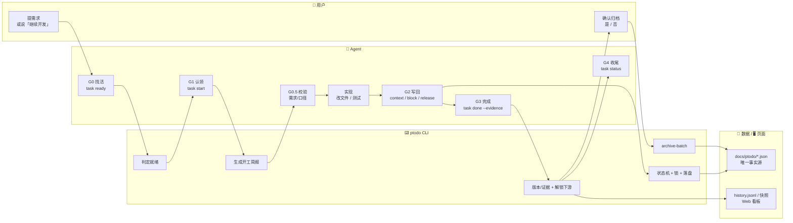
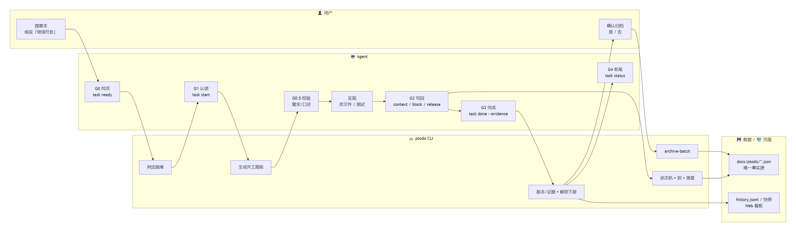
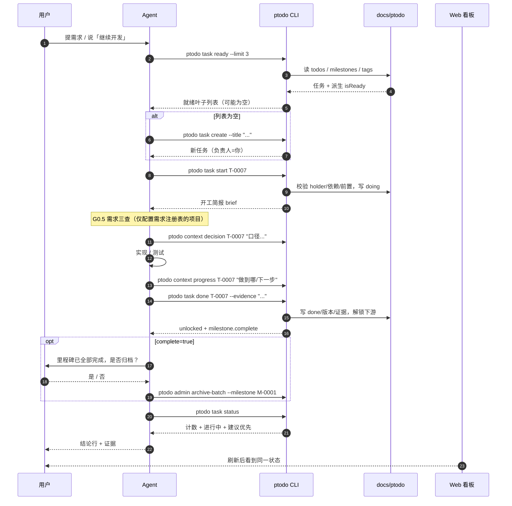
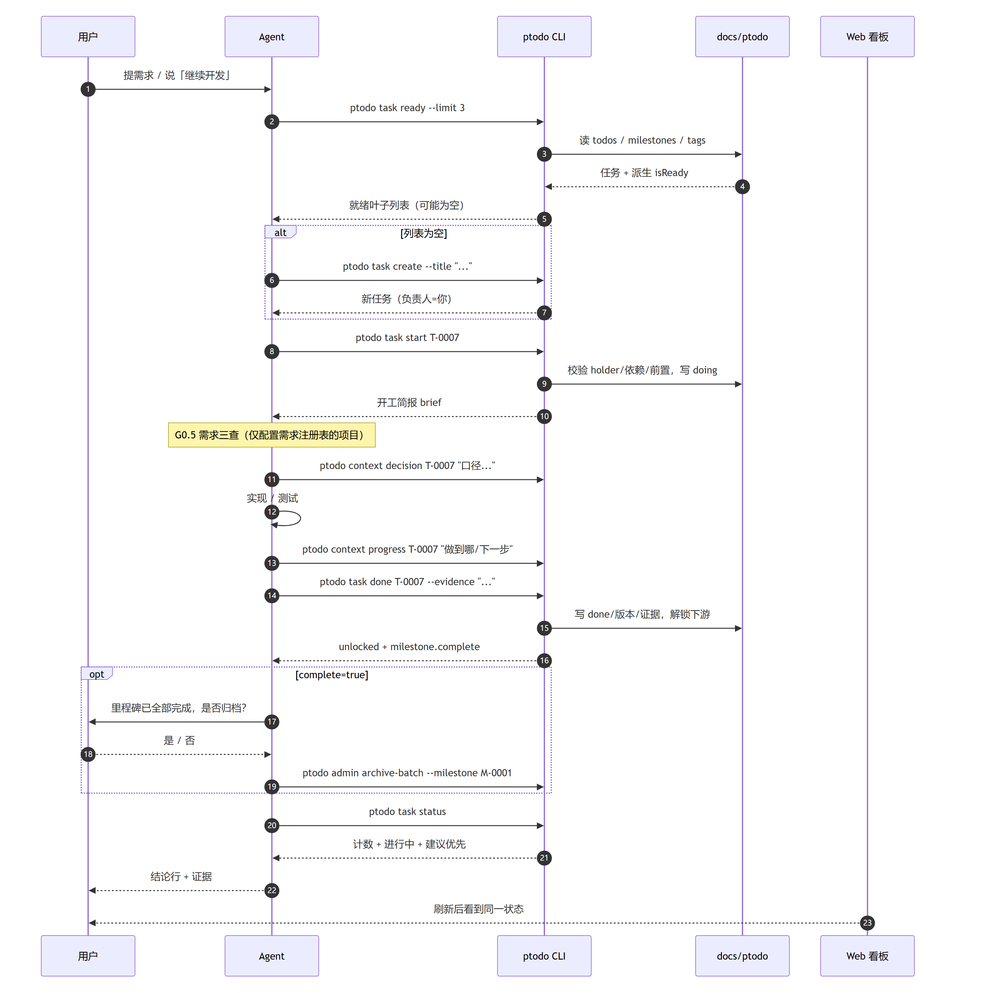
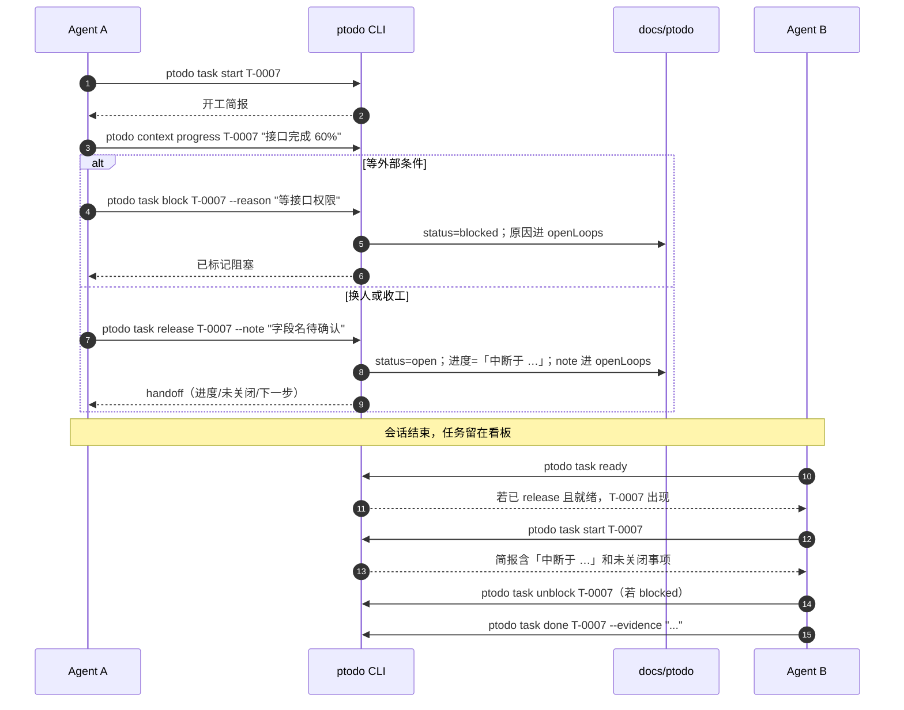
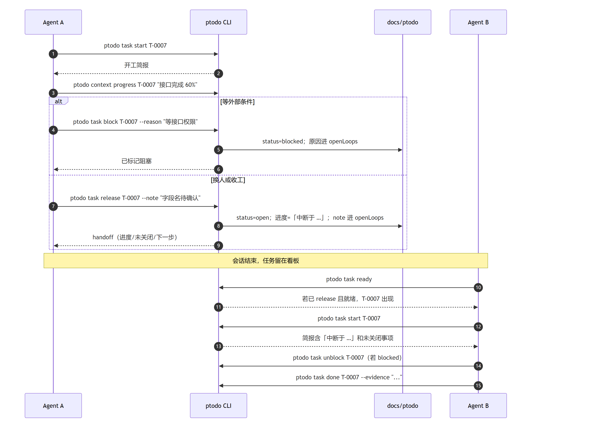
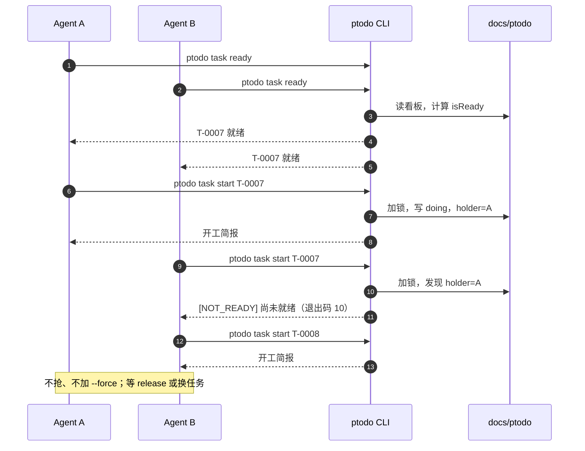
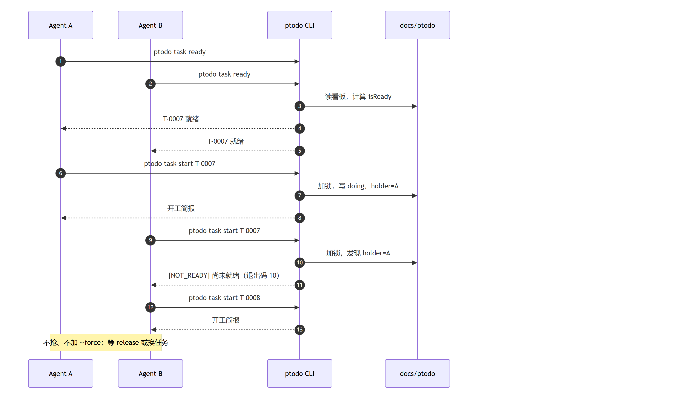
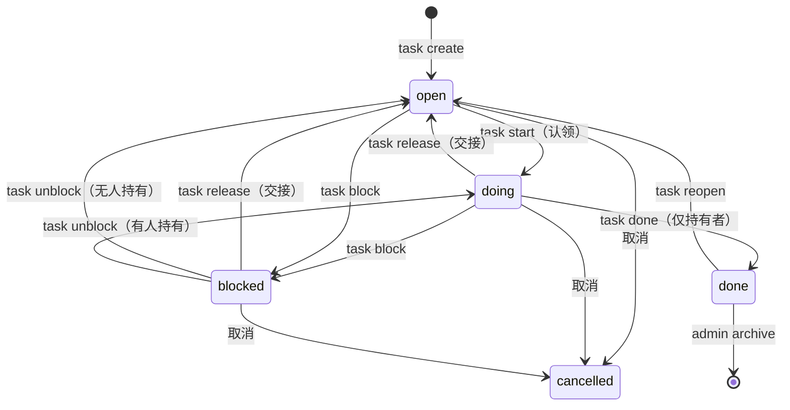
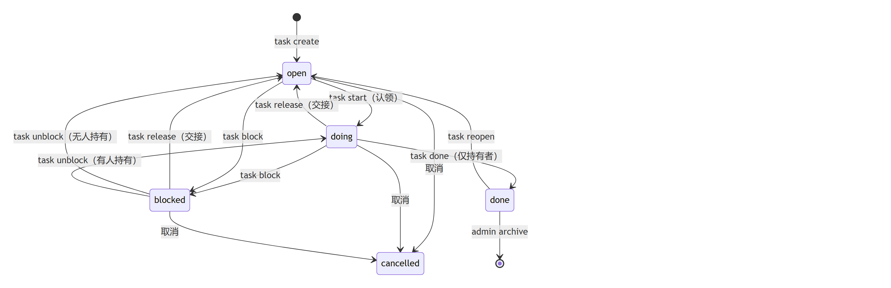

# ptodo 使用帮助

> 适用 2.0.x。本文讲清 **Agent 工具使用 ptodo 的完整生命周期**：谁在什么时机、用什么命令、读写什么。
> 只想知道怎么装：看 [README](../README.md#30-秒上手)。想改代码：看 [SPEC](../SPEC.md)。

## 目录

1. [一分钟结论](#1-一分钟结论)
2. [角色与职责](#2-角色与职责)
3. [生命周期总览（泳道图）](#3-生命周期总览泳道图)
4. [时序图：一次完整开发](#4-时序图一次完整开发)
5. [时序图：阻塞、交接与继续](#5-时序图阻塞交接与继续)
6. [时序图：多 Agent 并发](#6-时序图多-agent-并发)
7. [状态机](#7-状态机)
8. [时机速查表](#8-时机速查表)
9. [命令速查](#9-命令速查)
10. [输出怎么读](#10-输出怎么读)
11. [数据、初始化与迁移](#11-数据初始化与迁移)
12. [Web 看板](#12-web-看板)
13. [跨工具技能](#13-跨工具技能)
14. [FAQ](#14-faq)
15. [排障](#15-排障)
16. [术语表](#16-术语表)

## 1. 一分钟结论

一条命令流水线：

```text
ptodo task ready --limit 3      # G0 找活（不知道做什么时）
ptodo task start T-0007         # G1 认领 + 开工简报
ptodo context decision T-0007 "口径/选型"   # G0.5 校验（仅需求注册表项目）
ptodo context progress T-0007 "做到哪/下一步"
ptodo task done T-0007 --evidence "可复核证据" --version v1.2.3
ptodo task status               # G4 收尾，给结论行
```

六条红线：

1. **只走 `ptodo`**；不手改 `docs/ptodo/*.json`，不维护第二份待办。
2. **改文件前先 `start`**；`create` 默认把负责人设成你，所以自己建的任务不在 `ready` 里，直接 `start`。
3. **需求未校验不开工**（仅当项目配置了需求注册表）；没有注册表就跳过，别卡住。
4. **状态变化立即写回**：`progress / decision / loop / block / release`，不要等最后一次性补。
5. **没有 `done` 不说完成**；证据要能被别人复核。
6. **不抢 holder、不默认 `--force`**；`NOT_READY / CONFLICT` 时换任务或等释放。

> `ptodo task status`、`task list`、`task get` 是只读的；纯问答可以直接用，不必认领。

## 2. 角色与职责

| 角色 | 负责 | 不负责 |
|---|---|---|
| **用户 / 人类** | 提需求、说「继续开发」、确认归档、在看板上监督 | 不直接改 JSON；不替 Agent 抢任务 |
| **Agent（DSH / Codex / Claude / WorkBuddy / ZCode）** | 找活、认领、需求校验、实现、写回、完成、收尾 | 不绕过就绪判定；不手填任务 ID；不篡改证据 |
| **ptodo CLI** | 解析项目根、判定就绪、状态机、文件锁、原子落盘、生成简报 | 不替 Agent 做技术决策 |
| **数据层 `docs/ptodo/`** | 唯一事实源、历史日志、快照 | 不被手改；不被页面绕过 CLI 写 |
| **Web 看板「待办」** | 只读展示 + 有限写操作（开始/完成/阻塞恢复/释放/指派/归档/编辑描述） | 不提供依赖/前置/资料编辑，不提供删除/导入/清空日志 |

要点：

- **命令是唯一入口**。DSH 不再注册 `ptodo_*` 工具；Agent 通过 shell 调 `ptodo`，页面通过 Host HTTP 调同一套 `service.act()`。
- **页面与 CLI 看到的是同一份数据**；页面不做本地缓存，刷新即读盘。
- **多个 Agent 共用一块看板**；`holder` 是并发控制，不是建议。

## 3. 生命周期总览（泳道图）





怎么读这张图：

- **用户主要负责起点和归档确认**，也可以在看板上做有限的操作（开始/完成/释放/指派）。需求怎么拆、任务怎么领、证据怎么留，由 Agent 按门执行。
- **CLI 是唯一写入口**。页面上的「开始/完成/释放」也只是调用同一套 action，不会绕过 service 直接改数据层。
- **Agent 的每一步都要落到 CLI**。`ready` 决定做什么，`start` 认领并拿简报，`done` 才算完成；中间用 `context / block / release` 留痕。
- **数据层是结果，不是过程**。看板、历史、快照都由 CLI 写；排查时先看 `docs/ptodo/` 和 `ptodo timeline`。
- **页面是观察窗**。它不自动轮询，CLI 改完数据后点「刷新」即可。

## 4. 时序图：一次完整开发





### 4.1 会话开始

DSH 的 Host 会注入两段提示：常驻的「唯一入口/六个动作/禁止手改」和每个会话的「计数 + 进行中 + 建议优先」（≤400 字）。装了技能的工具还会加载 `project-todo` 执行协议。因此 Agent 不需要先问用户「待办在哪」。

### 4.2 G0：先看就绪

```bash
ptodo task ready --limit 3
```

输出示例：

```text
就绪任务：
  T-0003 [P0/紧急 3] 赛道展廊（分技术/业务赛道归档与永久展示） — 未分类
  T-0005 [P0/紧急 3] 真实算力下微调闭环与产物归档 — 未分类
```

返回空不代表没任务，按顺序排查：

1. 没有「未指派 + 就绪」的叶子（自己的任务带 holder，不在 `ready` 里）；
2. 硬依赖未完成；
3. 必填前置条件未满足（`pre list <id>`）；
4. 所属阶段/里程碑已归档；
5. 任务不是叶子（父任务永远不 ready）。

用户点名了任务：直接 `ptodo task start <id>`。用户说「继续开发」且无上下文：先 `ready --limit 3`，从第一条开始，不要反问「做哪个」。

### 4.3 G1：认领并拿简报

```bash
ptodo task start T-0007
```

这一步同时完成：检查就绪 → 写 `doing` + `holder=person` → 返回开工简报。已在本人名下时幂等，只回简报。

```text
开工简报：T-0007 导出接口支持流式
S-0002 实现 / M-0001 Q4 交付 · P1 · 紧急 普通
目标：导出 10 万行不 OOM，P95 < 2s
进度：接口骨架完成，待补测试
最近决策：
  - 选择流式导出，避免大文件内存峰值（codex:zhangsan）
前序已完成：
  - T-0006 导出协议冻结 · 版本 a1b2c3d · 证据 评审纪要第 3 节
未关闭事项：
  1. 等客户端确认字段名
下一步：先处理未关闭事项：等客户端确认字段名
```

**简报已包含 `get` 需要的全部信息，不要再 `task get` 重复读。**

### 4.4 G0.5：需求校验（有条件）

只有项目配置了需求注册表（例如 `utp/docs/prd/README.md`）时才做三查：

1. **查状态**：关联文档是否 `已取代/已作废/已归档` —— 是则停止，不采纳其 DoD；
2. **查 CR**：修订记录是否推翻这条需求 —— 用新口径；
3. **查实测**：最新版本文档的结论与 DoD 冲突 —— 以版本文档为准。

没有注册表 / 没有关联 PRD：**跳过三查，不阻塞**，只写回一句：

```bash
ptodo context decision T-0007 "无需求资产（<项目名>），按任务描述 DoD 执行"
```

有注册表时，把结论写回：

```bash
ptodo context decision T-0007 "G0.5 已查：注册表 R3 / CR-0007 / 版本 1.2.3；DoD@R3"
```

不能裁决的口径分歧（客户确认函未回执等）→ `ptodo task block T-0007 --reason "等客户确认口径"`，不实现、不改证据。

### 4.5 G2：边做边写回

| 时机 | 命令 | 写回什么 |
|---|---|---|
| 做了技术选型 | `context decision <id> "为什么/放弃了什么"` | 决策 |
| 完成一个子步骤 | `context progress <id> "做到哪/下一步"` | 进度（会被 release 改写为「中断于 …」） |
| 有待确认/待补测 | `context loop <id> "…"`；关闭用 `--close N` | 未关闭事项 |
| 外部条件卡住 | `task block <id> --reason "…"` | 状态 + openLoops |
| 换人/收工 | `task release <id> --note "…"` | 进度 + openLoops + handoff |
| 发现新工作 | `task create --title ... --parent <id> --blocked-by <id>` | 子任务/依赖 |

写回不是形式：下一位 `start` 只能看到你写进 `context` 的内容，看不到你的会话。

### 4.6 G3：完成

```bash
ptodo task done T-0007 --evidence "接口测试 12/12 通过" --version v0.1.0
```

- 只有当前持有者能完成；`--force` 才能越权（不要默认用）。
- 版本优先级：`--version` → `version.gitDir` → 当前 cwd → 项目根；取不到且 `version.require=true` → `[INVALID]`（退出码 5）。
- **非 git 项目必须带 `--version`**；工作区不是 git 仓很常见，不要因此谎报完成。
- 证据缺省时尝试 `git log --grep=<id>` 的提交摘要；能自动取到不等于可以糊弄，证据要可复核。
- 完成会解锁下游（返回值 `unlocked`），并返回 `milestone.complete`。

### 4.7 里程碑归档（强制先问）

文本输出会多一行：

```text
已完成 T-0007（版本 v0.1.0）
里程碑 M-0001 已全部完成；归档前先询问用户：ptodo admin archive-batch --milestone M-0001
```

处理规则：

1. **先问用户**「里程碑 M-0001（名称）已全部完成，是否归档？」；
2. 用户肯定后执行 `ptodo admin archive-batch --milestone M-0001`；
3. 用户拒绝则写回 `ptodo context loop T-0007 "里程碑 M-0001 待归档，用户暂不归档"`；
4. `milestone=null` 或 `complete=false` 不要提归档。

`archive-batch` 只归档该里程碑下**已完成**的叶子；未完成的进 `skipped`（NOT_DONE），不会被强制归档。`--include-open` 只是把未完成也纳入候选，仍会跳过。

### 4.8 G4：收尾

```bash
ptodo task status
```

最终答复必须带一行结论：

```text
待办：T-0007 已完成（版本 v0.1.0，证据 接口测试 12/12 通过）
```

或：

```text
待办：T-0007 仍进行中（阻塞：等接口权限；持有：zhangsan）
```

## 5. 时序图：阻塞、交接与继续





### 5.1 `block`：卡住就写原因

```bash
ptodo task block T-0007 --reason "等接口权限"
```

- `open | doing → blocked`；`--reason` 必填；
- 原因追加到 `context.openLoops`，下一位 `start` 能看到；
- 解除：`ptodo task unblock T-0007`（有人持有回 `doing`，否则回 `open`）。

### 5.2 `release`：交还而不是消失

```bash
ptodo task release T-0007 --note "字段名待确认，下一位先找客户端"
```

- `doing | blocked → open`；
- 进度改写为「中断于 <时间>：<原进度>」；
- `--note` 追加到 `openLoops`；
- 返回 `handoff = {id,title,progress,openLoops,note,nextStep}`。

### 5.3 接手的 Agent 怎么继续

下一位正常 `ready → start` 即可；`start` 简报会带「进度：中断于 …」和未关闭事项。不要跳过 `start` 直接改文件。

## 6. 时序图：多 Agent 并发





规则：

- `ready` 是**快照**，不是预留座位；两个人可能同时看到同一条。
- 先 `start` 成功的人拿到 `holder`；后到者会收到 `NOT_READY`（10）或 `CONFLICT`（4）。
- **不要默认 `--force`**。被持有时先 `task get <id>` 看 holder；换一条任务，或等对方 `release`。
- 想协作同一任务：一个人 `release --note` 后另一个人 `start`；不要同时改同一批文件。
- 人员与身份：`holder/createdBy/doneBy` 存 **person**（git `user.name`）；历史日志 `by` 存 **actor**（工具身份，建议 `工具:名字`）。两者不同是正常的。

## 7. 状态机





| 从 | 动作 | 到 | 命令 |
|---|---|---|---|
| — | 新建 | `open` | `task create` |
| `open` | 认领 | `doing` | `task start` |
| `doing` | 完成 | `done` | `task done`（仅持有者） |
| `doing` / `blocked` | 交还 | `open` | `task release` |
| `open` / `doing` | 阻塞 | `blocked` | `task block --reason` |
| `blocked` | 解除 | `doing` / `open` | `task unblock` |
| `done` | 重开 | `open` | `task reopen`（或 `admin reopen`） |
| `done` | 归档 | 移出活跃看板 | `admin archive / archive-batch` |
| 任意非 done | 取消 | `cancelled` | `task update --status cancelled` |

父任务规则：

- 父任务 = 容器：不可 `claim / release / done / block`，`holder` 恒 `null`；
- 状态由子任务自底向上汇总：全 cancelled → cancelled；非 cancelled 全 done → done；任一 doing → doing；否则 open；
- 依赖只能加在叶子上；给父任务加依赖 → `[INVALID]`。

## 8. 时机速查表

| 时机 | 触发条件 | 命令 | 读什么 | 写什么 / 注意 |
|---|---|---|---|---|
| 会话开始 | 这一回合要改文件/跑构建 | `task ready --limit 3` | 就绪叶子 | 不写；用户点名则直接 `start` |
| 用户说「继续开发」 | 无指定任务 | `task ready --limit 3` → `start` | 第一条就绪 | 不反问「做哪个」 |
| 认领 | 决定做哪条 | `task start <id>` | 开工简报 | `doing` + holder；简报已够，不再 `get` |
| 需求校验 | 有需求注册表 | `context decision <id> "..."` | 注册表状态/CR/版本 | 无注册表则跳过，不阻塞 |
| 技术选型 | 做了取舍 | `context decision` | — | 决策 + 放弃项 |
| 子步骤完成 | 每完成一块 | `context progress` | — | 进度 + 下一步 |
| 有待确认 | 需要客户/上游答复 | `context loop` | — | 未关闭事项；关闭用 `--close N` |
| 外部卡住 | 无法继续 | `task block --reason` | — | `blocked` + openLoops |
| 换人/收工 | 不再由你推进 | `task release --note` | handoff | 进度「中断于 …」+ note |
| 解除阻塞 | 条件满足 | `task unblock` | — | 有人持有回 doing；否则回 open，需要再 `start` |
| 发现新工作 | 需要拆任务 | `task create --title ...` | — | 默认负责人=你；可带 `--blocked-by` |
| 完成 | 证据可复核 | `task done --evidence` | `unlocked/milestone` | 版本/证据；解锁下游 |
| 里程碑全完成 | `milestone.complete=true` | 先问用户 → `admin archive-batch` | 用户答复 | 未确认不得归档 |
| 收尾 | 给结论前 | `task status` | 计数/进行中 | 结论行 |
| 只读问答 | 不改文件 | `task status / list / get` | — | 可跳过认领与 G0.5 |
| 被他人持有 | `NOT_READY / CONFLICT` | `task get <id>` | holder/状态 | 换任务或等 `release`，不 `--force` |
| 页面操作 | 人想看/改状态 | 看板按钮 | Tab/详情 | 只支持有限写；刷新看 CLI 变更 |
| 新项目接入 | 首次使用 | `init` / `doctor` | 自检结果 | 建默认组织；不覆盖已有数据 |
| 升级数据 | 旧布局/v2 | `migrate --dry-run` → `migrate` | 预览 | 自动备份；失败保留原文件 |
| 排障 | 异常 | `doctor` / `timeline` / `whoami` | 检查项 | 先定位根/actor/数据 |

## 9. 命令速查

完整参数、JSON 字段与示例见 [skill/project-todo/references/cli.md](../skill/project-todo/references/cli.md)。这里只列常用面。

### 9.1 全局

```text
ptodo <命令> [子命令] [参数] [--root DIR] [--by ACTOR] [--config FILE] [--json]
```

| 参数 | 说明 |
|---|---|
| `--root DIR` | 项目根；默认从 cwd 向上找 `docs/ptodo/todos.json`，再找 `.git`，都没有用 cwd |
| `--by ACTOR` | 工具身份；优先级 `--by` > `PTODO_ACTOR` > git `user.name` > `DSH_SESSION_ID` > `cli-<用户>` |
| `--config FILE` | 指定配置文件；默认 `docs/ptodo/config.json`（可缺省） |
| `--json` | stdout 恰好一个 JSON；错误 JSON 走 stderr |
| `--help` | 帮助；`ptodo --version` 打印包版本 |

列表参数（`--tags`、`--stages`、`--aliases`）支持逗号/顿号/分号分隔，也可重复传参。PowerShell 用户注意：未加引号的逗号会被当成参数分隔，写 `--tags "KB,api"`。

### 9.2 Agent 六动作

```bash
ptodo task ready [--limit N] [--stage S-0002] [--milestone M-0001]
ptodo task start <id>
ptodo task done <id> [--evidence "可复核证据"] [--version v] [--force]
ptodo task release <id> [--note "交接说明"] [--force]
ptodo task block <id> --reason "为什么卡住"
ptodo task create --title "..." [--stage S-0002] [--priority P0..P5] [--urgency 1..5]
                  [--tags a,b] [--parent <id>] [--notes "..."] [--blocked-by <id>]...
```

补充：

- `ready` 只返回**未指派 + 就绪**的叶子；`--stage`/`--milestone` 过滤。
- `start` 即认领；本人任务幂等；不就绪 → `NOT_READY`（10）；并发抢锁 → `CONFLICT`（4）。
- `done` 的版本/证据可自动取，但非 git 必须 `--version`；`--force` 越权，慎用。
- `release` 的 `--note` 会进 `openLoops`，是下一手的可见交接。
- `block` 的 `--reason` 必填。
- `create` 的 ID 由内核分配；默认 `P2`、urgency 3、阶段 `default`；标签未注册自动建 `draft`（`tag.strict=true` 时报 `TAG_NOT_FOUND`）。

### 9.3 任务管理

```bash
ptodo task list [--status open|doing|blocked|done|cancelled|all] [--tag T]
                [--stage S] [--milestone M] [--blocked] [--ready] [--archived] [--flat]
ptodo task get <id> [--no-history]
ptodo task update <id> [--title t] [--priority P] [--urgency N] [--tags a,b]
                     [--notes s] [--parent <id>] [--stage S] [--status s]
ptodo task status
ptodo task unblock <id>
ptodo task reopen <id>
ptodo task dep list <id>
ptodo task dep add <id> --blocked-by <depId> [--type hard|soft] [--note s]
ptodo task dep remove <id> --blocked-by <depId>
```

- `list` 默认按里程碑/阶段分组；`--flat` 平铺。
- `get` 返回父/子、context、依赖、前置、资料、历史、相关提交；`--no-history` 跳过历史。
- `dep add` 做全图成环检查；成环 → `DEPENDENCY_CYCLE`（8），不落盘。
- `status` 只读：计数 + 进行中 + 建议优先。

### 9.4 里程碑、阶段、标签

```bash
ptodo milestone create --name "Q4 交付" [--stages 调研,实现] [--description s]
ptodo milestone list|get|update|delete|dep ...
ptodo stage create --name "实现" [--milestone M-0001] [--description s]
ptodo stage list|get|update|reorder|delete|dep ...
ptodo tag add --name "知识库" [--code KB] [--aliases 别名1,别名2] [--status active|draft|deprecated]
ptodo tag update|deprecate|list|todos ...
```

- `milestone create --stages` 会按顺序建阶段（首个 active，其余 pending）。
- 默认里程碑/阶段自动存在、不可删；默认阶段不能移动、状态恒 active。
- `milestone delete --force` 把其下阶段迁到默认里程碑；`stage delete` 有任务时必须 `--move-to`。
- 组织依赖只产生 `effectiveStatus=blocked_by_upstream`，**永不阻塞任务就绪**。
- `tag deprecate` 用 `--replacement`（`--by` 已被全局 actor 占用）。

### 9.5 上下文、资料、前置、因果、Git、时间轴

```bash
ptodo context get <id>
ptodo context decision <id> "决策内容"
ptodo context progress <id> "当前进度"
ptodo context loop <id> "未关闭事项"
ptodo context loop <id> --close 1

ptodo res add <id> --title "需求文档" [--type doc] [--url ...] [--note ...]
ptodo res approve <id> <res-0001> [--note ...]
ptodo res supersede <id> <res-0001> --by-resource <res-0002>
ptodo res list <id> [--status draft|approved|superseded]

ptodo pre add <id> --type task_done --target <taskId>
ptodo pre add <id> --type tag_done --tag <code>
ptodo pre add <id> --type resource_approved --resource <res-id>
ptodo pre add <id> --type commit_exists --commit <hash>
ptodo pre add <id> --type manual_confirm [--optional]
ptodo pre confirm <id> <pc-0001> [--note s]
ptodo pre remove <id> <pc-0001>
ptodo pre list <id>

ptodo cause add <id> --type task|feedback|decision|resource|external --ref <引用> [--note s]
ptodo cause remove <id> --type ... --ref ...
ptodo cause list <id>
ptodo cause chain <id> [--depth 3]

ptodo git link [--dir DIR]
ptodo git hook install [--dir DIR] [--force]
ptodo git hook uninstall [--dir DIR] [--force]

ptodo timeline [--scope project|tag|task] [--tag T] [--task id] [--q 关键词]
               [--type task|dependency|org|tag|context|resource|precondition|cause|import]
               [--limit 20]
```

- 多个前置条件是 AND；`required=false` 恒视为满足；只有 `manual_confirm` 需要 `pre confirm`。
- 资料是**任务内**列表，不是全局库；被替换的旧资料标 `superseded`，并出现在下一次简报的「变更提示」。
- 因果纯叙事，不影响就绪与排期；`type=task` 会自动写反向边。
- `git link` 把仓库写进 `version.gitDir`；`--dir` 默认当前 shell 目录（不是 `--root`）。
- 时间轴默认 20 条、上限 200，最新在前；`--scope task` 额外返回字段级变化。

### 9.6 诊断、初始化、迁移、技能

```bash
ptodo whoami
ptodo doctor
ptodo init [--template simple|standard]
ptodo migrate [--dry-run] [--keep-legacy] [--force]
ptodo skill install|status|remove [--targets all|project|agents|dsh|zcode|workbuddy|claude|codex]
                                [--copy] [--force] [--home DIR]
```

- `whoami`：root、actor 来源、person、gitName、数据路径、revision。
- `doctor`：包/Node/看板/组织/标签/git/actor/依赖环/context/资料/技能；只提醒，不自动改。
- `init`：建空看板 + 默认组织；`standard` 另建 `tags.json` 和 `config.json`；已有数据不覆盖。
- `migrate`：旧 `.dsh` 布局 → `docs/ptodo`，或 v2 看板 → v3；先备份，可 `--dry-run`。

### 9.7 页面/脚本专用 `admin`

不要教给 Agent 的常规流程；页面和脚本使用。

```bash
ptodo admin reopen|unblock|archive|unarchive|delete <id>
ptodo admin archive-batch --milestone M-0001 [--include-open]
ptodo admin archive-batch --stage S-0002
ptodo admin archive-batch --ids T-0007,T-0008
ptodo admin claim-batch [--tag T] [--limit N]
ptodo admin release-batch [--tag T]
ptodo admin check
ptodo admin timeline [--scope ...]
ptodo admin timeline-clear --confirm
ptodo admin import [--source <path>] [--dry-run]
ptodo admin import-file <file> [--format md|xlsx] [--dry-run]
ptodo admin export [--format md|xlsx] [--scope active|archive|all]
ptodo admin people
```

`--format xlsx` 生成 `总览`（KPI、状态/优先级/里程碑/标签统计、4 张图表）与 `任务明细`（配色、冻结表头、筛选、打印设置）两张表；纯 JS 生成，不需要 Python/openpyxl。导出失败时面板显示错误信息，不会保存成坏文件。

### 9.8 退出码

| 码 | 含义 | 常见处理 |
|---|---|---|
| 0 | 成功 | — |
| 1 | 通用错误 | 看 stderr |
| 2 | 用法错误 | 改参数 |
| 3 | `NOT_FOUND` | 检查 ID / 路径 |
| 4 | `CONFLICT` | 被他人持有、锁占用、已依赖；换一条或稍后 |
| 5 | `INVALID` | 参数/状态非法；非 git 时补 `--version` |
| 6 | `PARSE_ERROR` / `IO_ERROR` | JSON 损坏/读写失败；从备份恢复 |
| 7 | `NO_PROJECT` | `cd` 到项目或传 `--root` |
| 8 | `DEPENDENCY_CYCLE` | 依赖成环，删边后重加 |
| 9 | `TAG_NOT_FOUND` | 严格模式未注册标签，先 `tag add` |
| 10 | `NOT_READY` | 硬依赖/前置未满足，或被持有/阶段归档 |

## 10. 输出怎么读

### 10.1 `ready`

```text
就绪任务：
  T-0003 [P0/紧急 3] 赛道展廊 — 未分类
```

格式：`ID [优先级/紧急等级] 标题 — 阶段`。`--json` 返回 `{ok,action:"ready",counts,tasks}`。

### 10.2 `start` 简报字段

| 字段 | 含义 | 怎么用 |
|---|---|---|
| `task/stage/milestone` | 归属与优先级 | 确认没领错 |
| `goal` | 任务目标 | 对齐验收 |
| `progress` | 当前进度/中断点 | 接着做，不重来 |
| `decisions` | 最近 3 条决策 | 不推翻已定选型 |
| `upstreamDone` | 已完成上游 + 版本/证据 | 直接引用，不重复验证 |
| `upstreamPending` | 未完成上游 | 先做上游或换任务 |
| `changes` | 资料被替换、上游更新 | 复核后再动手 |
| `resources` | 资料（approved/draft/superseded） | 先看 approved |
| `openLoops` | 未关闭事项 | 优先处理 |
| `preconditions` | 前置条件 | 未满足先补 |
| `blocking` | 被谁依赖 | 完成后谁会被解锁 |
| `nextStep` | 系统建议的下一步 | 参考，不盲从 |

### 10.3 `done`

```text
已完成 T-0007（版本 v0.1.0）；解锁 T-0008
被解锁：T-0008
里程碑 M-0001 已全部完成；归档前先询问用户：ptodo admin archive-batch --milestone M-0001
```

`--json` 额外有 `version / evidence / unlocked / milestone`。`milestone.complete=true` 才提归档。

### 10.4 `release`

```text
已释放 T-0007
进度：中断于 2026-11-04 16:34：接口骨架完成，待补测试
未关闭：等客户端确认字段名；先做别的，字段名待确认
下一步：从「中断于 …」继续
```

### 10.5 `block` / `status`

```text
已标记阻塞 T-0007：等客户端确认字段名

项目待办：进行中 1，未开始 31，阻塞 0，已完成 13。
进行中：T-0007 导出接口（zhangsan）
建议优先：T-0003 [P0/紧急 普通] 赛道展廊；T-0004 [P0/紧急 普通] 模型本地部署加载
```

### 10.6 JSON 契约

- `--json`：stdout 恰好一个 JSON；文本提示走 stderr。
- 变更类：`{ok:true, action, message, ...}`，只带该动作相关字段。
- 查询类：`tasks / task / entries / checks` 等完整对象。
- 错误：stderr 一行 `{"ok":false,"code":"CONFLICT","message":"..."}`。
- `⚠` 开头的行是 warning（如标签未注册、版本文档缺失），不改变退出码。

## 11. 数据、初始化与迁移

### 11.1 项目根怎么定

1. 从 cwd 向上最多 9 层，**先整条链找 `docs/ptodo/todos.json`**，命中即该目录；
2. 都没有，再找 `.git`，命中即该目录；
3. 都没有 → 用 cwd 本身，首次写入时创建数据目录。

CLI 可用 `--root` 覆盖，`PTODO_ROOT` 次之。Web 侧由 Host 用会话工作目录解析，浏览器不传路径。

### 11.2 文件

| 文件 | 版本 | 用途 |
|---|---|---|
| `docs/ptodo/todos.json` | v3 | 活跃看板（唯一事实源） |
| `docs/ptodo/milestones.json` | v1 | 里程碑与阶段 |
| `docs/ptodo/tags.json` | v1 | 标签注册表 |
| `docs/ptodo/archive.json` | v2 | 已归档任务 |
| `docs/ptodo/todos.history.jsonl` | — | 只追加操作日志 |
| `docs/ptodo/config.json` | — | 可选配置 |
| `.dsh/TODO.md`、`.dsh/ARCHIVE.md` | — | 只写 Markdown 快照（不读） |

### 11.3 配置示例

```yaml
store:      { path: docs/ptodo/todos.json }
milestones: { path: docs/ptodo/milestones.json }
tags:       { path: docs/ptodo/tags.json }
archive:    { afterDays: 3, path: docs/ptodo/archive.json }
history:    { enabled: true, path: docs/ptodo/todos.history.jsonl }
markdown:   { enabled: true, path: .dsh/TODO.md, archivePath: .dsh/ARCHIVE.md, doneLimit: 20 }
version:    { auto: true, require: true, gitDir: "" }
ui:         { enabled: true, defaultTab: auto }
tag:        { strict: false }
context:    { maxDecisions: 50, maxOpenLoops: 20 }
skill:      { targets: [project, agents, dsh, zcode, workbuddy, claude, codex] }
batch:      { claimLimit: 3 }
```

优先级：默认值 < 文件 < loader 行配置。非法值回退默认值，不阻断加载；配置文件损坏是硬错误。

### 11.4 初始化与迁移

```bash
ptodo init                        # 空看板 + 默认里程碑/阶段
ptodo init --template standard     # 另建 tags/config

ptodo migrate --dry-run            # 预览任务数、标签、备份位置
ptodo migrate                      # v2→v3；备份到 docs/ptodo/.backup/v2-<时间>/
ptodo migrate --keep-legacy        # 旧 .dsh 布局：保留旧 JSON
```

- 不跑 `migrate` 时，v3 首次写入也会先备份 v2 文件。
- 旧 `.dsh` 布局迁移保留任务/ID/revision/nextId，旧 history 按约定丢弃。
- 目标已存在且内容不同需 `--force`（会先备份）。
- 不做旧布局回退。

### 11.5 并发与一致性

- 每次变更：进程内队列 + `.lock`（含 pid/时间）→ 重读 → 校验 → `revision+1` → 原子写（temp+fsync+rename）→ 追加历史 → 重写快照。
- 锁等待 2 秒，超 10 秒视为陈旧；获取失败 → `CONFLICT`（4）。
- 自动归档：读取时 sweep，`archive.afterDays`（默认 3，0 关闭）后把完成的叶子移入 `archive.json`。
- 派生字段每次读取重算，不落库；损坏 JSON 拒绝写入并保留原文件。

## 12. Web 看板

入口：DSH 会话页的「待办」标签页。页面只调 Host 的回环 HTTP，不直接读文件。

### 12.1 布局与视图

- **Tab**：全部 / 就绪 / 进行中 / 被阻塞 / 已完成 / 已归档；计数跟随标签、搜索、人员过滤。
- **视图**：自动（默认）/ 平铺 / 按里程碑。自动 = 只有默认组织时平铺，出现其他里程碑或非默认阶段则分组。选择存浏览器 localStorage。
- **分组层级**：里程碑（品牌色竖条 + 编码 + 进度）→ 阶段（缩进、可折叠）→ 任务（缩进 + 竖线）。
- **人员**：默认「与我相关」（负责人/创建人/完成人），可多选或切「全部人员」；来源是 git 历史作者 + 看板已有人员。
- **详情**：只读展示 context、依赖、blocking、前置、资料、因果、相关提交；「最近变更」是竖向流转图。

### 12.2 能做什么、不能做什么

可以：开始、完成（弹窗填版本+证据）、阻塞恢复、释放（可带说明）、指派负责人、归档/批量归档、编辑标题/优先级/紧急度/标签/备注。

不可以：编辑依赖/前置/资料/因果，删除任务、取消归档、导入、批量认领/释放、清空日志。这些只走 `ptodo admin`，避免页面绕过状态机。

### 12.3 与 CLI 的关系

- 同一个项目、同一份 `todos.json`；页面动作也走 `service.act()`。
- 页面不自动轮询；CLI 或其他会话改动后点「刷新」。
- 页面写请求需要回环 + 同源/客户端标识鉴权，只在本机可用。

## 13. 跨工具技能

技能源码在 `skill/project-todo/`，安装后各工具用同一份协议和同一个数据根。

```bash
ptodo skill install --targets all
ptodo skill install --targets project,codex
ptodo skill status
ptodo skill remove --targets all
```

| target | 路径 |
|---|---|
| project | 项目 `.agents/skills/project-todo` |
| agents | `~/.agents/skills` |
| dsh | `~/.dsh/skills` |
| zcode | `~/.zcode/skills` |
| workbuddy | `~/.workbuddy/skills` |
| claude | `~/.claude/skills` |
| codex | `~/.codex/skills` |

Windows 优先目录 junction，失败回退复制；`--copy` 强制复制。更新技能源码后，链接安装无需重装；复制安装需重装。

DSH 另有 Host 注入的常驻提示和会话摘要，即使 Agent 没加载技能，也知道待办在哪、该用哪六个动作。

## 14. FAQ

**Q1：`task ready` 为空，是不是没任务？**
不一定。`ready` 只列「未指派 + 就绪」的叶子。自己 `create` 的任务默认负责人是你，所以不在列表里，直接 `start`。其他原因：硬依赖未完成、必填前置未满足、阶段/里程碑归档、任务不是叶子、被他人持有。

**Q2：`create` 之后为什么 `ready` 看不到？**
同上，`create` 默认 `holder=person`。这是刻意的：新建任务默认归你，避免刚建就被别人抢。要让给别人：先 `start` 变成 `doing`，再 `release --note`，任务回 `open` 且清空 holder，才会进入就绪池。

**Q3：`done` 报 `[INVALID]`？**
非 git 项目/目录取不到版本，补 `--version <版本>`。其他 `[INVALID]` 多半是参数/状态非法；具体看 stderr。若状态不是 `doing` 或不是 holder，会先报 `[CONFLICT]` 而不是 `[INVALID]`。

**Q4：任务被他人持有怎么办？**
`task get <id>` 看 holder；换一条，或等对方 `release`。不要默认 `--force`，那会制造两份「已完成」。

**Q5：`NOT_READY` 和 `CONFLICT` 有什么区别？**
`NOT_READY`（10）：硬依赖/前置未满足，或被持有/阶段归档，任务不能开工。`CONFLICT`（4）：抢锁失败、被他人持有、依赖已存在、阶段仍有任务等操作冲突。都先查状态，不要绕过。

**Q6：里程碑全完成必须归档吗？**
不必须。`done` 返回 `milestone.complete=true` 时**先问用户**；用户拒绝就写 `context loop` 记住，不归档。未确认不得归档。

**Q7：能直接改 `docs/ptodo/*.json` 吗？**
不能。会绕过 `revision`、锁、历史、派生字段和快照，导致并发覆盖。所有变更走 `ptodo`；导入用 `admin import-file`，迁移用 `migrate`。

**Q8：能删任务吗？**
页面不提供；CLI 用 `ptodo admin delete <id> [--cascade] [--purge]`。常规流程用取消/归档，不删除。

**Q9：多个 Agent 同时做会怎样？**
`holder` 保证同一时刻只有一个人持有；后到者收到 `NOT_READY`。可以并行做不同任务，但不要同时改同一批文件。交接用 `release --note`。

**Q10：页面为什么没更新？**
页面不自动轮询；点「刷新」。仍不更新：确认插件已加载（profile `bundles`）、会话工作目录解析到正确项目根、Host 没报错。

**Q11：依赖和前置条件有什么区别？**
依赖是任务之间的边（`hard/soft`，带成环检测），前置是开工门槛（`task_done/tag_done/resource_approved/commit_exists/manual_confirm`）。硬依赖未完成或必填前置未满足都会让任务不 ready。组织依赖（阶段/里程碑）只影响组织状态，不阻塞任务。

**Q12：父任务为什么不能 `start`？**
父任务是容器，状态由子任务汇总。父任务 `holder` 恒 `null`，不能认领/完成/阻塞；拆成叶子任务再执行。

**Q13：非 git 项目能用吗？**
能。除了 `done` 必须带 `--version`，其余功能不受影响；`doctor` 会提示「无 git」和「版本文档缺失」。

**Q14：能接入 Jira/飞书吗？**
当前不内置。数据是公开 JSON，可用 `admin export` 导出 md/xlsx，或自行读 `todos.json` 做同步；不要反向手写 JSON。

## 15. 排障

### 15.1 先跑 `doctor`

```text
ptodo 2.0.2 · E:\java\fuyao-ai
✅ package  @local/dsh-project-todo@2.0.2
✅ node     22.19.0
✅ root     E:\java\fuyao-ai
✅ board    ...\docs\ptodo\todos.json（revision 96，46 条）
✅ org      ...\milestones.json（M 1 / S 1）
✅ tags     ...\tags.json（9 个，draft 9）
✅ archive  ...\archive.json
✅ history  ...\todos.history.jsonl
✅ snapshot ...\.dsh\TODO.md
⚠ git      当前目录无 git，完成时需 --version
⚠ actor    optimisticGeek（git） — 建议把 PTODO_ACTOR 设为 <agent>:<名称>
⚠ context  目标缺失率 100%
✅ deps     无任务依赖成环
✅ skills   project:linked agents:linked dsh:linked ...
```

| 检查项 | 含义 | 异常时 |
|---|---|---|
| package/node | 包与 Node 版本 | 重装/升级 Node >= 20 |
| root | 项目根解析 | `--root` 或 `cd` |
| board/org/tags | 数据文件与版本 | 损坏则从备份恢复；缺失可 `init` |
| git | 版本来源 | 无 git 就每次 `done --version` |
| actor | 身份解析 | 设 `PTODO_ACTOR=<工具>:<名字>` |
| version | 版本文档缺失提醒 | 按提示补文档；只提醒不阻断 |
| deps | 依赖环 | 删边重加 |
| context | 目标缺失率 | 只提醒；当前版本 goal 只读展示，缺失不阻断 |
| resources | 资料过期引用 | 复核或替换 |
| skills | 技能安装 | `skill install` |

### 15.2 常见错误

| 现象 | 原因 | 处理 |
|---|---|---|
| `ptodo` 找不到 | 未 link / PATH 不含 npm 全局 bin | `npm link` 或 `npm i -g .`；确认全局 bin 在 PATH（`npm config get prefix`） |
| `[NO_PROJECT]` | 不在项目内且无 `--root` | `cd` 到项目根或传 `--root` |
| `[PARSE_ERROR]` | JSON 损坏/版本不符 | 从 `docs/ptodo/.backup/` 恢复；不要手改 |
| `[DEPENDENCY_CYCLE]` | 依赖成环 | `task dep remove` 删边后重加 |
| `[TAG_NOT_FOUND]` | `tag.strict=true` 且标签未注册 | `tag add` 或关闭 strict |
| 中文标签被拆 | PowerShell 逗号分隔 | `--tags "KB,api"` |
| 技能没生效 | 未安装/工具未重启 | `skill status` → `skill install` → 重启工具 |
| 页面 404/空白 | profile 未加载/工作目录错 | 查 `bundles`、重启 DSH、确认会话目录 |
| 锁一直冲突 | 遗留 `.lock`（超 10 秒视为陈旧） | 确认无进程写后删除 `docs/ptodo/todos.json.lock` |
| `whoami` 的 person 不对 | 无 git `user.name`，回落到 actor 去前缀 | `git config user.name` 或设 `PTODO_ACTOR` |

### 15.3 数据恢复

- 每次变更写快照；`migrate` 与 v2 首次写入都会备份到 `docs/ptodo/.backup/`。
- 历史日志 `todos.history.jsonl` 只追加，可用 `ptodo timeline` 追溯；`admin timeline-clear --confirm` 只清日志，不动任务/归档/revision。
- 损坏 JSON 时 ptodo 拒绝写入并保留原文件；先备份现场，再从最近备份恢复，最后 `doctor`。
- 不要用编辑器批量重写 `todos.json`；会丢 `revision` 并破坏锁语义。

### 15.4 Windows 注意事项

- 使用 PowerShell 时给含逗号的列表加引号：`--tags "KB,api"`、`--stages "调研,实现"`。
- 技能安装优先目录 junction；没有权限时自动回退复制，之后更新源码要重新 `skill install --force`。
- 路径含空格时用引号；`--root "E:\My Project"`。
- 非 git 工作区很常见：`done` 记得带 `--version`。

## 16. 术语表

| 术语 | 含义 |
|---|---|
| 看板 | `docs/ptodo/todos.json` 中的活跃任务集合 |
| 里程碑 `M-xxxx` | 交付节奏分组，挂阶段 |
| 阶段 `S-xxxx` | 批次/模块分组，挂任务 |
| 任务 `T-xxxx` | 可执行叶子；ID 内核分配、不复用 |
| 叶子 | 没有子任务的任务；只有叶子能认领/完成 |
| 就绪 `isReady` | 叶子 + open + 无 holder + 硬依赖完成 + 必填前置满足 + 组织未归档 |
| holder | 当前持有者（person），并发控制 |
| person | 完成人/负责人，git `user.name` |
| actor | 工具身份，`--by`/`PTODO_ACTOR`，建议 `工具:名字` |
| 开工简报 | `start` 返回的阶段/目标/上游/资料/loop/下一步投影 |
| 硬/软依赖 | 硬依赖阻塞就绪；软依赖只提示 |
| 前置条件 | 开工门槛（任务/标签/资料/提交/人工确认） |
| 交接 | `release` 写回进度、note、handoff |
| 归档 | 完成的叶子移出活跃看板，进 `archive.json` |
| 快照 | `.dsh/TODO.md` / `ARCHIVE.md`，只写不读 |
